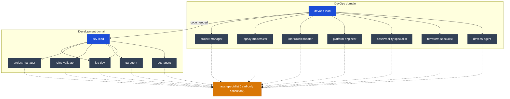
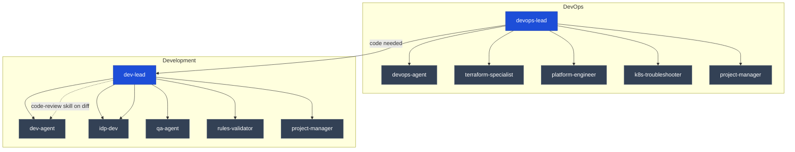

# dotfiles-ai-config

Personal configuration for **Kiro CLI**, **GitHub Copilot CLI** and **Claude Code**: agents, skills, steering/instructions, hooks and settings.

Languages: **English** (this file) · [Português (pt-BR)](README.pt-BR.md)

## Repository layout

```
bin/
  kiro-cli-login            # Kiro CLI login via Windows from WSL (install into ~/bin)
claude/                     # Claude Code  -> ~/.claude/
  CLAUDE.md                 # always-loaded instructions (summary of the rules)
  README.md                 # Claude-only architecture notes
  agents/                   # subagents (~/.claude/agents/*.md), 11 agents
  skills/                   # skills (~/.claude/skills/<name>/SKILL.md)
  settings.json             # env (model IDs), default model, modelSettings, mcpServers, permissions
kiro/                       # Kiro CLI     -> ~/.kiro/
  agents/                   # agents (~/.kiro/agents/*.json), 14 agents
  prompts/                  # system prompts used by the agents (~/.kiro/prompts/*.md)
  knowledge/                # per-agent reference docs (~/.kiro/knowledge/<agent>/*.md)
  steering/                 # steering docs (~/.kiro/steering/*.md)
  skills/                   # skills (~/.kiro/skills/<name>/SKILL.md)
  hooks/                    # hooks (~/.kiro/hooks/*.json): block-secret-reads, guard-destructive-cmds
  settings/                 # mcp.json, cli.json (~/.kiro/settings/)
kiro-crew/                  # Kiro variant for the Windows/Crew environment (no Kiro-only tools)
copilot/                    # GitHub Copilot CLI -> ~/.copilot/
  copilot-instructions.md   # global instructions (~/.copilot/copilot-instructions.md)
  agents/                   # custom agents (~/.copilot/agents/*.agent.md)
  skills/                   # skills (~/.copilot/skills/<name>/SKILL.md)
```

## Hierarchy

Both setups use the same idea: two tech-lead orchestrators (DevOps and Dev), each routing work to specialists and running a gate before delivery. Leads never write the code or run the ops work themselves. Project management is shared by both sides.

### Kiro CLI



| Agent | Role |
|---|---|
| `devops-lead` | DevOps tech lead. Keeps a todo list, routes ops work to the right specialist, runs the gate, delivers. Does not do ops work itself |
| `devops-agent` | EKS/AKS, Terraform, GitOps, GitHub. Read-first, writes via CLI |
| `terraform-specialist` | Terraform (`k8s-infra`, `aws-infra`, `terraform-gh-env`): AVM modules, import/moved, validate, reads the CI plan. Local = `init -backend=false` + `validate` only; never plan/apply |
| `observability-specialist` | Splunk first: SPL queries, Splunk O11y APM/detectors, OTel instrumentation via GitOps PR. Read-only on clusters |
| `platform-engineer` | Internal developer platform (Backstage + Crossplane + ArgoCD): golden paths, templates, XRD/Composition YAML, `render` tests. Code goes to `idp-dev` |
| `k8s-troubleshooter` | Investigates app errors on AKS/EKS (GitOps, app repo, infra, DB/DNS). Same permissions as devops-agent plus denies on prod mutations and `az keyvault secret show` |
| `legacy-modernizer` | Migrates legacy .NET apps: containers (Core, 4.8 Windows), IIS, Web App, classic/Azure pipelines to GitHub Actions. Secrets/vars guardrails |
| `dev-lead` | Dev tech lead. Keeps a todo list, splits features into tasks, spawns workers, runs the gate, delivers. Never merges |
| `dev-agent` | Implements code and unit tests on `feat/*` / `fix/*`. No merge, no push to main |
| `idp-dev` | Senior dev for the platform: Backstage plugins/modules (TS), scaffolder actions, Crossplane functions (Go). Plans first, reuses upstream, tests |
| `qa-agent` | Runs the repo's test runner, reports pass/fail and coverage gaps. Does not edit code |
| `rules-validator` | Read-only PASS/FAIL audit of a branch/PR against the work rules (build, labels, trailer, scope, secrets) |
| `project-manager` | Requirements and tracking (one agent, two modes): specs with acceptance criteria, per-agent breakdown, PROJ cards, status. Never marks Done |
| `aws-specialist` | Read-only AWS consultant that other agents can call as a subagent. Changes go to the owning agent |

Start: `kiro-cli chat --agent <name>`, then describe the problem in a normal message.

### Claude Code

Same DevOps/Dev split, using Claude Code's `Task` tool for spawning and `TodoWrite` for todo lists. Steering became skills (`claude/skills/*`), loaded by description match. This setup has no `aws-specialist`, `observability-specialist` or `legacy-modernizer`, and no separate semantic reviewer: review is done by invoking the `code-review` skill on the diff.



| Agent | Role |
|---|---|
| `devops-lead` | DevOps tech lead. Uses `TodoWrite`, routes to specialists, runs the gate, delivers |
| `devops-agent` | CI/CD, pipelines, Dockerfiles, GitOps manifests, GitHub ops |
| `terraform-specialist` | Terraform work. Plan comes from CI; local = `init -backend=false` + `validate` only |
| `platform-engineer` | Platform design (golden paths, templates, schemas). Hands code to `idp-dev` through `dev-lead` |
| `k8s-troubleshooter` | Evidence-first incident RCA. Fixes go through PRs, never `kubectl edit/patch` on GitOps-managed resources |
| `dev-lead` | Dev tech lead. Uses `TodoWrite`, splits features, runs the gate, delivers. Never merges |
| `dev-agent` | Implements code and unit tests on `feat/*` / `fix/*` |
| `idp-dev` | Platform code (plugins, modules, actions, automation functions). Plans first, reuses upstream |
| `qa-agent` | Runs the test runner, reports pass/fail. Runs on `haiku` with low effort |
| `rules-validator` | Read-only PASS/FAIL audit against the hard rules. Runs on `haiku` with low effort |
| `project-manager` | Specs, acceptance criteria, task breakdown, status. Never marks Done |

Start: run `claude` in a project. Claude Code discovers `~/.claude/agents/` and `~/.claude/skills/` automatically.

#### Models (Claude Code)

| Alias | Model ID | Env var |
|---|---|---|
| `opus` | `claude-opus-5-5` | `ANTHROPIC_DEFAULT_OPUS_MODEL` |
| `sonnet` | `claude-sonnet-5-5` | `ANTHROPIC_DEFAULT_SONNET_MODEL` |
| `haiku` | `claude-haiku-5-5` | `ANTHROPIC_DEFAULT_HAIKU_MODEL` |

- Default session model and effort are set in `claude/settings.json` (`model`, `modelSettings`). Keys in `modelSettings` must be exact model IDs (for example `claude-sonnet-5-5`), otherwise the setting is ignored.
- Per-agent `model:` and `effort:` live in each agent's frontmatter.

## Kiro CLI notes

- After editing an agent JSON, run `kiro-cli agent upgrade ~/.kiro/agents` and check that no `"*"` deny appeared. `agent validate` does not catch this; open a session to test.
- Agent files use absolute paths (`/home/<user>/...`) in `prompt` and `resources`. Adjust them if your home directory differs.
- Engine v3 needs the prompt inline in the JSON (it does not read `prompt: file://...`) and an explicit `permissions` block.

## Todo lists

Lead agents (`devops-lead`, `dev-lead`, `project-manager`) must keep a todo list. Each item = outcome + owner + proof. Gates are items. An item is only ticked after the lead has checked the evidence itself. Kiro uses the `todo_list` tool; the Crew variant (no such tool) uses a file under `~/work/__kiro-cli/temp/`; Claude Code uses `TodoWrite`.

## Copilot CLI

Custom agents in `copilot/agents/*.agent.md` and skills in `copilot/skills/`, with global instructions in `copilot/copilot-instructions.md`. Copilot has no `aws-specialist`, `observability-specialist` or `legacy-modernizer`.

## Installation

Symlink or copy each folder into its tool's directory:

```sh
ln -s "$PWD/claude" ~/.claude            # or copy the contents
ln -s "$PWD/kiro"   ~/.kiro
ln -s "$PWD/copilot" ~/.copilot
install -m 755 bin/kiro-cli-login ~/bin/
```

## Secrets

`kiro/settings/mcp.json`, `claude/settings.json` and the Copilot MCP config contain placeholder tokens. Provide `GITHUB_PERSONAL_ACCESS_TOKEN` (and any other token) through the environment or a secret manager. Never commit real values.
