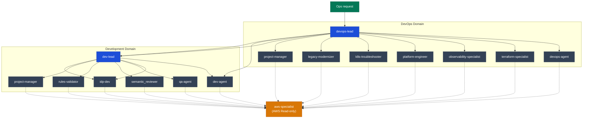

# dotfiles-ai-config

Configs pessoais usadas com **Kiro CLI** e **GitHub Copilot CLI**.

## Estrutura

```
copilot/
  copilot-instructions.md   # instructions globais do Copilot CLI (~/.copilot/copilot-instructions.md)
  agents/                   # custom agents (~/.copilot/agents/*.agent.md): devops-team + port dos agents Kiro (8)
  skills/                   # skills (~/.copilot/skills/*/SKILL.md): inclui steering do Kiro portado (work-rules, workflow-path-triggers, jira-cards, dev-team, playbooks)
kiro/
  agents/                   # agents (~/.kiro/agents/*.json): devops-lead + devops-agent, legacy-modernizer, k8s-troubleshooter, terraform-specialist, observability-specialist, platform-engineer; dev-lead + dev-agent, idp-dev, qa-agent, rules-validator; project-manager (cross-team)
  prompts/                  # system prompts dos agents (~/.kiro/prompts/*.md) + habblaud-install.md
  knowledge/                # docs de referência por agent (~/.kiro/knowledge/<agent>/*.md)
  steering/                 # steering docs (~/.kiro/steering/*.md)
  skills/                   # skills (~/.kiro/skills/<name>/SKILL.md): enterprise-report (HTML/PDF reports)
  settings/                 # mcp.json (token = placeholder, preencher local), cli.json (~/.kiro/settings/)
  skills/                   # skills (~/.kiro/skills/*/SKILL.md): enterprise-report, gmud-create, task-handoff
  hooks/                    # hooks (~/.kiro/hooks/*.json): guard-destructive-cmds, block-secret-reads
bin/
  kiro-cli-login            # login Kiro CLI via Windows no WSL (instalar em ~/bin)
```

## Agents (Kiro)

| Agent | Uso |
|---|---|
| `devops-agent` | EKS/AKS, Terraform, GitOps, GitHub. Read-first, write via CLI |
| `legacy-modernizer` | Migrar apps .NET legadas: containers (Core, 4.8 Windows), IIS, Web App, pipelines classic/Azure -> GitHub Actions. Guardrails de secrets/vars |
| `k8s-troubleshooter` | Investigar erros de apps em AKS/EKS: gitops, repo da app, infra, DB/DNS. Mesmas permissões do devops-agent + deny (mutações em prd, `az keyvault secret show`) |
| `dev-agent` | Implementa código + testes unitários em `feat/*`/`fix/*`. Sem merge, sem push em main |
| `qa-agent` | Roda o test runner do repo, reporta pass/fail + lacunas de cobertura. Não edita código |
| `rules-validator` | Auditoria read-only de branch/PR vs work-rules (build, labels, trailer, escopo, secrets). Veredito PASS/FAIL |
| `dev-lead` | Tech lead do time de dev. Usa todo list. Quebra feature em tarefas, spawna dev-agent / idp-dev / qa-agent / semantic_reviewer / rules-validator / project-manager, roda o gate, entrega. Não escreve código, nunca faz merge |
| `devops-lead` | Tech lead do time de devops. Usa todo list. Roteia o trabalho ao especialista certo (devops-agent / terraform-specialist / observability-specialist / platform-engineer / k8s-troubleshooter / legacy-modernizer / project-manager), roda o gate, entrega. Versão Windows/Crew em `kiro-crew/` |
| `terraform-specialist` | Terraform (`k8s-infra`, `aws-infra`, `terraform-gh-env`): AVM, import/moved, validate, leitura do plan do CI. Local = `init -backend=false` + `validate`; nunca plan/apply |
| `observability-specialist` | Splunk primeiro: SPL (índices `ix_{dvp,hml,prd}_{aks,eks}`), Splunk O11y APM/detectors, instrumentação OTel via PR no gitops. Read-only nos clusters |
| `platform-engineer` | IDP: Backstage + Crossplane + ArgoCD. Desenha golden paths, escreve template/XRD/Composition (YAML), testa com `render`; código vai pro `idp-dev` |
| `idp-dev` | Dev sênior do IDP (time dev): plugins/módulos Backstage (TS), scaffolder actions, Crossplane functions (Go). Planeja antes, reusa upstream, testa. Sem merge, sem push em main |
| `aws-specialist` | Consultor AWS que qualquer agent chama (subagent). Conhece `development-us`, `homologation-us`, `production-us`, `network-us`, TGW/VPC/endpoints/Resolver. Só leitura, com evidência; mudança vai pro dono (terraform-specialist / devops-agent) |
| `project-manager` | Requisitos + gestão de tarefas (um agente, dois modos): spec com critérios de aceite, quebra por agente, cards PROJ, status. Sem código, nunca marca Done |

Iniciar: `kiro-cli chat --agent <nome>` e descrever o problema numa mensagem normal.

## Todo lists

`devops-lead`, `dev-lead` e `project-manager` trabalham com todo list obrigatória (steering `todo-discipline.md`): item = resultado + dono + prova, gates viram itens, só marca feito com evidência verificada pelo lead. No Kiro CLI usa a tool `todo_list`; no Crew (sem a tool) usa arquivo em `~/work/__kiro-cli/temp/`.

## Hierarquia



> Engine v3: prompt vai inline no JSON (o v3 não lê `prompt: file://...`, log `Provider 'file' not found`) e o agent precisa de `permissions` (formato universal). Depois de editar um agent: `kiro-cli agent upgrade ~/.kiro/agents` e conferir que não apareceu deny `"*"`. `agent validate` não pega isso: teste abrindo uma sessão.
> Os arquivos de agent usam paths absolutos `/home/nathan/...` em `prompt` e `resources`. Ajustar se o usuário/home for outro.
> O `agent_config.json` antigo foi renomeado para `devops-agent.json` (o nome do agent vem do nome do arquivo).

## Uso

Symlink ou copiar os arquivos para os respectivos diretórios (`~/.copilot/`, `~/.kiro/`).

> `mcp.json` tem token mascarado — configurar `GITHUB_PERSONAL_ACCESS_TOKEN` via env/secret, nunca commitar valor real.
