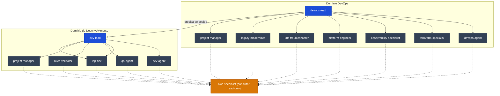
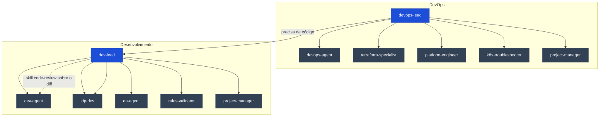

# dotfiles-ai-config

Configuração pessoal para **Kiro CLI**, **GitHub Copilot CLI** e **Claude Code**: agents, skills, steering/instruções, hooks e settings.

Idiomas: [English](README.md) · **Português (pt-BR)** (este arquivo)

## Estrutura do repositório

```
bin/
  kiro-cli-login            # login do Kiro CLI via Windows a partir do WSL (instalar em ~/bin)
claude/                     # Claude Code  -> ~/.claude/
  CLAUDE.md                 # instruções sempre carregadas (resumo das regras)
  README.md                 # notas de arquitetura só do Claude
  agents/                   # subagents (~/.claude/agents/*.md), 11 agents
  skills/                   # skills (~/.claude/skills/<nome>/SKILL.md)
  settings.json             # env (IDs de modelo), modelo padrão, modelSettings, mcpServers, permissions
kiro/                       # Kiro CLI     -> ~/.kiro/
  agents/                   # agents (~/.kiro/agents/*.json), 14 agents
  prompts/                  # system prompts dos agents (~/.kiro/prompts/*.md)
  knowledge/                # docs de referência por agent (~/.kiro/knowledge/<agent>/*.md)
  steering/                 # docs de steering (~/.kiro/steering/*.md)
  skills/                   # skills (~/.kiro/skills/<nome>/SKILL.md)
  hooks/                    # hooks (~/.kiro/hooks/*.json): block-secret-reads, guard-destructive-cmds
  settings/                 # mcp.json, cli.json (~/.kiro/settings/)
kiro-crew/                  # variante do Kiro para o ambiente Windows/Crew (sem as tools exclusivas do Kiro)
copilot/                    # GitHub Copilot CLI -> ~/.copilot/
  copilot-instructions.md   # instruções globais (~/.copilot/copilot-instructions.md)
  agents/                   # custom agents (~/.copilot/agents/*.agent.md)
  skills/                   # skills (~/.copilot/skills/<nome>/SKILL.md)
```

## Hierarquia

Os dois setups usam a mesma ideia: dois tech leads orquestradores (DevOps e Dev), cada um roteando o trabalho para especialistas e rodando um gate antes da entrega. Os leads nunca escrevem código nem executam o trabalho de ops. Gestão de projeto é compartilhada pelos dois lados.

### Kiro CLI



| Agent | Função |
|---|---|
| `devops-lead` | Tech lead de DevOps. Mantém todo list, roteia o trabalho de ops para o especialista certo, roda o gate, entrega. Não executa trabalho de ops |
| `devops-agent` | EKS/AKS, Terraform, GitOps, GitHub. Read-first, escreve via CLI |
| `terraform-specialist` | Terraform (`k8s-infra`, `aws-infra`, `terraform-gh-env`): módulos AVM, import/moved, validate, leitura do plan do CI. Local = só `init -backend=false` + `validate`; nunca plan/apply |
| `observability-specialist` | Splunk primeiro: queries SPL, Splunk O11y APM/detectors, instrumentação OTel via PR no GitOps. Read-only nos clusters |
| `platform-engineer` | Plataforma interna (Backstage + Crossplane + ArgoCD): golden paths, templates, YAML de XRD/Composition, testes com `render`. Código vai para o `idp-dev` |
| `k8s-troubleshooter` | Investiga erros de apps em AKS/EKS (GitOps, repo da app, infra, DB/DNS). Mesmas permissões do devops-agent, com deny para mutações em prod e `az keyvault secret show` |
| `legacy-modernizer` | Migra apps .NET legadas: containers (Core, 4.8 Windows), IIS, Web App, pipelines classic/Azure para GitHub Actions. Guardrails de secrets/vars |
| `dev-lead` | Tech lead de dev. Mantém todo list, divide a feature em tarefas, cria workers, roda o gate, entrega. Nunca faz merge |
| `dev-agent` | Implementa código e testes unitários em `feat/*` / `fix/*`. Sem merge, sem push na main |
| `idp-dev` | Dev sênior da plataforma: plugins/módulos Backstage (TS), scaffolder actions, funções Crossplane (Go). Planeja antes, reusa upstream, testa |
| `qa-agent` | Roda o test runner do repo, reporta pass/fail e lacunas de cobertura. Não edita código |
| `rules-validator` | Auditoria read-only com veredito PASS/FAIL de branch/PR contra as regras de trabalho (build, labels, trailer, escopo, secrets) |
| `project-manager` | Requisitos e acompanhamento (um agent, dois modos): specs com critérios de aceite, divisão por agent, cards PROJ, status. Nunca marca Done |
| `aws-specialist` | Consultor AWS read-only que outros agents podem chamar como subagent. Mudanças vão para o agent dono |

Iniciar: `kiro-cli chat --agent <nome>` e descrever o problema em uma mensagem normal.

### Claude Code

Mesma divisão DevOps/Dev, usando a tool `Task` do Claude Code para criar subagents e `TodoWrite` para o todo list. O steering virou skills (`claude/skills/*`), carregadas por descrição. Este setup não tem `aws-specialist`, `observability-specialist` nem `legacy-modernizer`, e não há um semantic reviewer separado: a revisão é feita chamando a skill `code-review` sobre o diff.



| Agent | Função |
|---|---|
| `devops-lead` | Tech lead de DevOps. Usa `TodoWrite`, roteia para especialistas, roda o gate, entrega |
| `devops-agent` | CI/CD, pipelines, Dockerfiles, manifests GitOps, operações no GitHub |
| `terraform-specialist` | Trabalho com Terraform. O plan vem do CI; local = só `init -backend=false` + `validate` |
| `platform-engineer` | Design da plataforma (golden paths, templates, schemas). Entrega código para o `idp-dev` via `dev-lead` |
| `k8s-troubleshooter` | RCA de incidentes baseada em evidência. Correções passam por PR, nunca `kubectl edit/patch` em recursos gerenciados pelo GitOps |
| `dev-lead` | Tech lead de dev. Usa `TodoWrite`, divide features, roda o gate, entrega. Nunca faz merge |
| `dev-agent` | Implementa código e testes unitários em `feat/*` / `fix/*` |
| `idp-dev` | Código da plataforma (plugins, módulos, actions, funções de automação). Planeja antes, reusa upstream |
| `qa-agent` | Roda o test runner, reporta pass/fail. Usa `haiku` com effort low |
| `rules-validator` | Auditoria read-only PASS/FAIL contra as regras. Usa `haiku` com effort low |
| `project-manager` | Specs, critérios de aceite, quebra de tarefas, status. Nunca marca Done |

Iniciar: rode `claude` em um projeto. O Claude Code descobre `~/.claude/agents/` e `~/.claude/skills/` automaticamente.

#### Modelos (Claude Code)

| Alias | ID do modelo | Variável de ambiente |
|---|---|---|
| `opus` | `claude-opus-5-5` | `ANTHROPIC_DEFAULT_OPUS_MODEL` |
| `sonnet` | `claude-sonnet-5-5` | `ANTHROPIC_DEFAULT_SONNET_MODEL` |
| `haiku` | `claude-haiku-5-5` | `ANTHROPIC_DEFAULT_HAIKU_MODEL` |

- O modelo padrão da sessão e o effort ficam em `claude/settings.json` (`model`, `modelSettings`). As chaves de `modelSettings` precisam ser IDs exatos (por exemplo `claude-sonnet-5-5`), senão a configuração é ignorada.
- `model:` e `effort:` por agent ficam no frontmatter de cada agent.

## Notas do Kiro CLI

- Depois de editar um agent JSON, rode `kiro-cli agent upgrade ~/.kiro/agents` e confira que não apareceu deny `"*"`. `agent validate` não pega isso; abra uma sessão para testar.
- Os arquivos de agent usam caminhos absolutos (`/home/<usuario>/...`) em `prompt` e `resources`. Ajuste se o seu home for outro.
- O engine v3 exige o prompt inline no JSON (não lê `prompt: file://...`) e um bloco `permissions` explícito.

## Todo lists

Os agents líderes (`devops-lead`, `dev-lead`, `project-manager`) precisam manter um todo list. Cada item = resultado + dono + prova. Gates são itens. Um item só é marcado depois que o líder verificou a evidência. O Kiro usa a tool `todo_list`; a variante Crew (sem essa tool) usa um arquivo em `~/work/__kiro-cli/temp/`; o Claude Code usa `TodoWrite`.

## Copilot CLI

Custom agents em `copilot/agents/*.agent.md` e skills em `copilot/skills/`, com instruções globais em `copilot/copilot-instructions.md`. O Copilot não tem `aws-specialist`, `observability-specialist` nem `legacy-modernizer`.

## Instalação

Crie um symlink ou copie cada pasta para o diretório da ferramenta correspondente:

```sh
ln -s "$PWD/claude" ~/.claude            # ou copie o conteúdo
ln -s "$PWD/kiro"   ~/.kiro
ln -s "$PWD/copilot" ~/.copilot
install -m 755 bin/kiro-cli-login ~/bin/
```

## Segredos

`kiro/settings/mcp.json`, `claude/settings.json` e a config MCP do Copilot têm tokens de placeholder. Forneça `GITHUB_PERSONAL_ACCESS_TOKEN` (e qualquer outro token) pelo ambiente ou por um gerenciador de segredos. Nunca commite valores reais.
